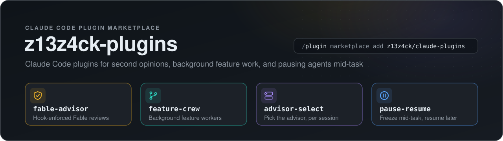
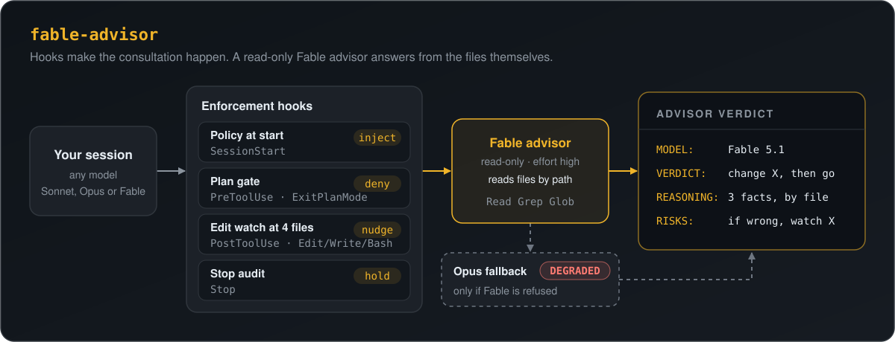
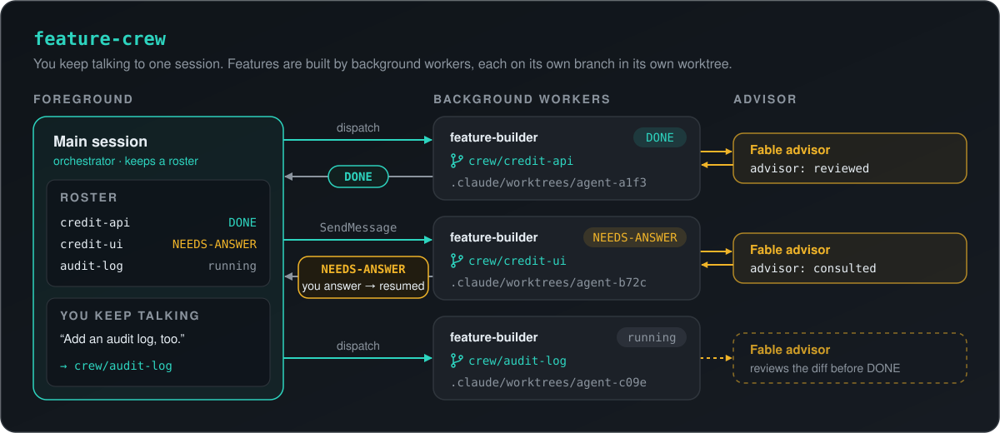
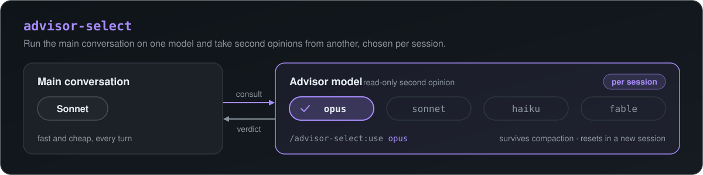
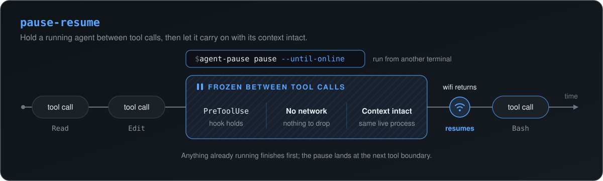

<p align="center">
  
</p>

# z13z4ck-plugins — Claude Code plugin marketplace

Four plugins for running Claude Code on bigger work: a second-opinion advisor
that the harness actually makes the model use, a crew of background workers
that build features on their own branches while you keep talking, a model
picker for the advisor, and a way to freeze an agent mid-task and pick it up
later.

```
/plugin marketplace add z13z4ck/claude-plugins
```

| Plugin | What it does |
|---|---|
| [fable-advisor](plugins/fable-advisor/README.md) | A read-only second-opinion advisor on Fable (the `fable` alias — Fable 5.1 today) with a labelled Opus fallback, plus hooks that enforce consulting it: policy at every session start, `ExitPlanMode` gated, unadvised multi-file turns held for review — inside background workers too |
| [feature-crew](plugins/feature-crew/README.md) | Turn one session into an orchestrator: features you ask for are built by background workers, each on its own `crew/*` branch in its own worktree, while your conversation stays free |
| [advisor-select](plugins/advisor-select/README.md) | Pick which model advises this session (`opus`, `sonnet`, `haiku`, `fable`) — e.g. main conversation on Sonnet, second opinions from Opus |
| [pause-resume](plugins/pause-resume/README.md) | Freeze a running agent between tool calls and thaw it later with context intact — for moving locations, losing connectivity, or sleeping the laptop mid-task |

**How they fit together.** fable-advisor and feature-crew are built to run
side by side: the orchestrator hands features to workers, each worker
consults Fable on its own design calls and gets its diff reviewed before it
reports, and fable-advisor's hooks hold any worker that tries to finish a
large change unreviewed. advisor-select is the lighter alternative when you
want to choose the advisor model per session instead of always using Fable.
pause-resume works with any of them.

# fable-advisor — a Fable second opinion the harness makes you use

<p align="center">
  
</p>

Run your session on any model. Consult a read-only Fable advisor — dispatched
through the `fable` alias, so Fable 5.1 on current Claude Code, at `high`
reasoning effort with `xhigh` a one-line opt-up — for architectural
decisions, plan reviews, and stalled debugging. It is a replacement path for
sessions where Claude Code's built-in advisor tool is not attached (a Fable
5.1 main model accepts only a Fable 5.1 advisor, so a saved Opus advisor
silently stops applying): the plugin dispatches Fable through the standard
subagent mechanism instead, and degrades to Opus with a clear label if Fable
itself is refused. On a session that already runs Fable, the value is a
fresh-context, file-grounded second look rather than a capability jump.

```
/plugin install fable-advisor@z13z4ck-plugins
/fable-advisor:health               # run this FIRST — confirms Fable is reachable
/fable-advisor:consult <question>   # second opinion (--model <alias> to override once)
/fable-advisor:review-plan          # critique the current plan before executing it
/fable-advisor:status               # consultations this session, unreviewed edits, active hooks
```

Consultation is enforced, not just suggested. Hooks put the advisor policy in
context at every session start and after every compaction, flag prompts that
call for advice as they arrive, deny `ExitPlanMode` until the plan has been
sent to the advisor, nudge once four distinct files have been edited without
a consultation (Bash heredocs and `sed -i` count), and hold a turn that
edited four or more files unadvised once at its end, asking for a
verification review before it finishes. Background workers — by default
feature-crew's `feature-builder` — get their own policy, tally and
end-of-run hold inside their worktrees, and their reviews never count for
the session that started them. `FABLE_ADVISOR_ENFORCE=nudge` keeps the
reminders and drops the gates.

Every verdict opens with a MODEL line, so a silently substituted model can't
pass as Fable — including when Claude Code's own safety-classifier fallback
or `fallbackModel` chain re-runs the subagent on Opus. The health check
treats "answered as another model" as degraded, not operational, and a
failed dispatch retries once on a fallback labelled "ADVISOR RUNNING
DEGRADED". Hook table, configuration and a CLAUDE.md policy snippet:
[plugins/fable-advisor](plugins/fable-advisor/README.md).

# feature-crew — one session as an orchestrator for background feature work

<p align="center">
  
</p>

Talk to one session; it hands each feature or revision to a background
`feature-builder` worker on its own `crew/<slug>` branch in an isolated
worktree, and your conversation stays free. The main session keeps a roster,
relays a worker's `NEEDS-ANSWER` question to you, resumes that same worker
with your answer, and reports each `DONE` with branch, changes, what was
verified and the advisor's verdict. With fable-advisor installed, workers
consult it themselves — on design calls, stalled bugs, and a review of any
diff of four or more files — and the main session checks that verdict
before reporting. Nothing is merged, pushed or deleted unless you ask.

```
/plugin install feature-crew@z13z4ck-plugins   # project scope recommended
```

No commands to learn — install, restart, and talk normally. The policy turns
every session where it is active into an orchestrator, so enable it per
project (`FEATURE_CREW=off` in user settings, `on` where you want it); it
stays inactive outside a git repository. After a resume it lists the
`crew/*` branches that exist, since workers stop when their session ends.
Limits and worktree housekeeping:
[plugins/feature-crew](plugins/feature-crew/README.md).

# advisor-select — pick which model advises your session

<p align="center">
  
</p>

Run your main conversation on any model and choose, per session, which model
serves as your read-only second-opinion advisor. The canonical setup: main
session on Sonnet (fast, cheap), advisor on Opus (deep judgment on the calls
that matter).

```
/plugin install advisor-select@z13z4ck-plugins
/advisor-select:use opus            # this session's advisor (opus | sonnet | haiku | fable)
/advisor-select:health              # confirm the selected model actually answers
/advisor-select:consult <question>  # get a second opinion (--model <alias> to override once)
/advisor-select:review-plan         # critique the current plan before executing it
```

`/advisor-select:use` with no argument shows the current selection and asks
interactively. The choice is stored per session ID, so it survives context
compaction and resets automatically in a new session (default: Opus). If the
selected model is unavailable, the consultation retries once on a fallback
and labels the verdict "ADVISOR RUNNING DEGRADED" — and every verdict opens
with a MODEL line, so a silently substituted model can't pass as your
selection. Proactive (no-command) use and a CLAUDE.md policy snippet:
[plugins/advisor-select](plugins/advisor-select/README.md).

# pause-resume — stop an agent mid-task and come back to it

<p align="center">
  
</p>

You cannot pause an agent mid-API-call, but an agent spends most of its life
*between* tool calls — and Claude Code waits for a `PreToolUse` hook to finish
before each one. So the hook doesn't finish. Nothing runs, no request goes to
the API, and the whole conversation stays resident in the process. Clear the
flag and the agent carries on with every byte of context it had, unaware
anything happened.

```
/plugin install pause-resume@z13z4ck-plugins
/pause-resume:install-cli          # pausing has to come from outside the session
```

```bash
agent-pause pause --until-online   # freeze now, thaw itself when wifi returns
agent-pause pause --in 10m         # keep working, freeze when I leave
agent-pause resume                 # continue
agent-pause status                 # what is held, at which tool, for how long
```

Because a freeze makes no network traffic, there is no connection to drop;
because it is a sleeping poll loop, suspending the machine suspends it too.
When a session dies before you could pause it, `/pause-resume:recover` rebuilds
a resume brief from the transcript Claude Code was writing to disk all along.
How it fails safe when the hook itself is killed:
[plugins/pause-resume](plugins/pause-resume/README.md).

## Requirements

- Claude Code 2.1.257 or later for Fable 5.1 through the `fable` alias
  (`claude update`). Restart after installing or updating a plugin: hooks
  load at session start.
- fable-advisor's hooks need Python 3 on `PATH` (`python3`, or `python` /
  `py -3` on Windows); without it they are a silent no-op.
- feature-crew needs a git repository; its hook needs only bash and git.
  pause-resume's pause and resume need only bash; the resume brief it writes
  when a session is cut off needs Python 3. Both run under Git Bash on
  Windows.

## Development

Each plugin with hooks has a self-contained test suite that never touches
real session state:

```bash
bash plugins/fable-advisor/tests/run-tests.sh
bash plugins/feature-crew/tests/run-tests.sh
bash plugins/pause-resume/tests/run-tests.sh
```

`claude plugin validate .` checks the marketplace manifest, and
`claude plugin validate plugins/<name>` checks one plugin.

## License

[MIT](LICENSE) © Aziz (z13z4ck)
